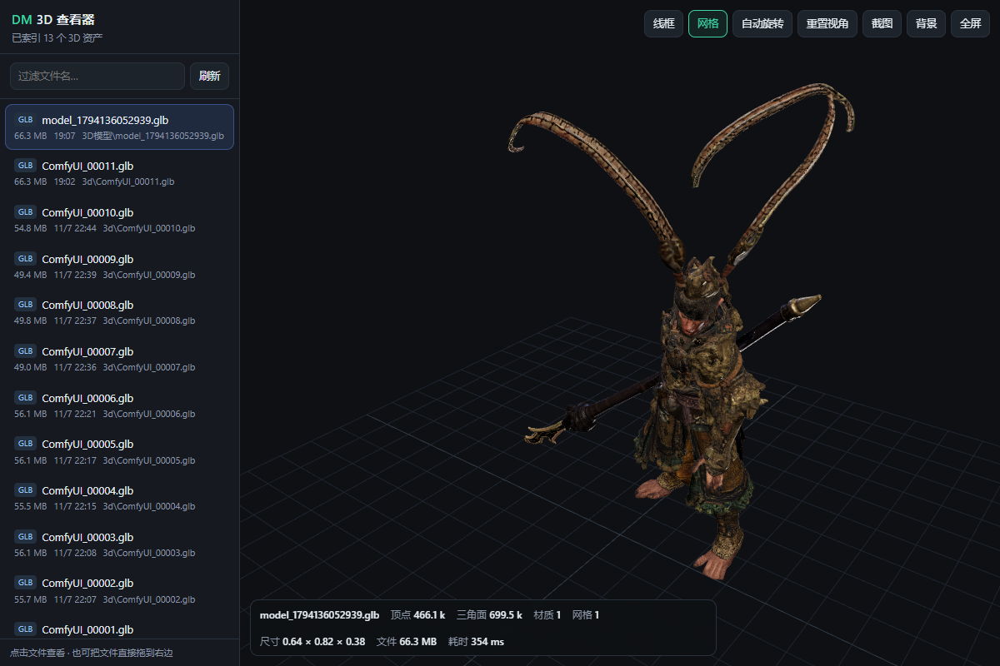

# DM 3D Viewer · ComfyUI 3D 资产浏览台

> 一个**零依赖、零联网**的本地 3D 查看器：自动扫出 ComfyUI 产出的 `.glb / .obj / .ply / .stl`，
> 点一下就看，顺带显示**顶点/三角面/材质/包围盒/解析耗时**，还能一键截图。
> 附带一个**自动归档器**：新模型自动进你的素材库、按指纹去重 —— 再也不用点 ComfyUI 那个"下载"按钮。



*(实测样本：66.3 MB、466.1k 顶点、699.5k 三角面，解析 354~426 ms，带贴图)*

---

## 为什么做这个

ComfyUI 的 3D 节点（Hunyuan3D / Trellis / 3D 预览类）把模型写在
`ComfyUI\output\3d\ComfyUI_000xx.glb`，但界面上只给你一个"下载"按钮：

- 每次点都要确认"另存为"，一天十几次；
- 下载出来叫 `model_<13位毫秒>.glb`，同一次生成点三次就是三份 66 MB；
- 想对比 00010 / 00011 哪版好，得逐个用 Blender 打开（慢）。

这个工具补这层：**列出来 → 点开看 → 看统计 → 截图**，全程本地、不传任何数据。

## 特性

| 能力 | 说明 |
|---|---|
| 资产浏览 | 按修改时间倒序列出多个目录里的 3D 文件，带大小/时间/子路径，支持过滤搜索 |
| 极速渲染 | three.js r169（**已内置**，不需要 CDN/联网），66 MB / 70 万三角面解析 0.4 s |
| 格式 | `.glb` `.gltf`（含 Draco）· `.obj` · `.ply`（网格或点云）· `.stl` · `.fbx` · `.3mf` |
| 统计 | 顶点 / 三角面 / 材质 / 网格数 / 包围盒 / 文件大小 / 解析耗时 |
| 操作 | 线框 W · 网格 G · 自动旋转 空格 · 重置 R · **头部特写 H** · 材质修正 M · 截图 PNG · 背景切换 · 全屏 |
| 拖拽 | 任意 3D 文件直接拖进窗口就看（不需要在扫描目录里）|
| 右键 | 「用系统默认程序打开」，想丢给 Blender 就丢 |
| 深链 | `http://127.0.0.1:8123/?p=D:\path\to\model.glb` 直接打开指定文件 |
| 大文件 | 服务端按 1 MB 分块 + 支持 HTTP Range，不会把 66 MB 读进内存 |

## 快速开始

需要 **Python 3.9+**（只用标准库，不用 pip 装任何东西）。

```bash
git clone https://github.com/dxyliwei520/comfyui-dm-3d-viewer.git
cd comfyui-dm-3d-viewer

# Windows
start-viewer.bat
# macOS / Linux
./start-viewer.sh
# 或者
python server.py
```

浏览器会自动打开 **http://127.0.0.1:8123/**（只绑 `127.0.0.1`，外网/局域网访问不到）。

### 扫描哪些目录

默认扫这几种（**不存在的自动跳过**）：

```
D:\ComfyUI_experimental\...\ComfyUI\output
F:\ComfyUI_windows_portable_nvidia\...\ComfyUI\output
E:\游戏素材库                          ← 作者自己的归档目录
./models                              ← 仓库内（.gitignore 已排除）
```

自定义：

```bash
python server.py --dir "E:\my\models" --dir "D:\another"
# 或环境变量（分号分隔）
set  DM3D_DIRS=E:\my\models;D:\another              # cmd
$env:DM3D_DIRS="E:\my\models;D:\another"            # PowerShell
export DM3D_DIRS=/data/models:/data/more            # macOS/Linux
```

## 自动归档（不用再手动"保存"）

```bash
python archiver.py                     # 持续盯（每 5 秒扫一次）
python archiver.py --once              # 只扫一轮
python archiver.py --import-existing   # 把现有的也归档（默认首轮只记基线）
```

- 监听：`DM3D_WATCH`（分隔符 `;`）或默认的 ComfyUI `output` + `~/Downloads`
- 归档到：`DM3D_LIB`，否则 `<盘>:\游戏素材库\3D模型`（存在就用），再否则 `~/DM3D-Assets`
- 命名：`<日期>/<时分秒>_<原名>`；**指纹去重**（大小 + 前 1 MB sha1）→ 同一模型下载 N 次只留 1 份
- 单实例锁：重复启动会自己退出

### Windows：开机常驻且**不闪黑窗**

`wscript` 是 GUI 宿主，用它彻底没有控制台窗口（本项目实测踩出来的）：

```vbs
' dm-3d-archiver.vbs
Set sh = CreateObject("WScript.Shell")
sh.Run """<python.exe>"" -X utf8 ""<本目录>\archiver.py"" --interval 5", 0, False
```

```bat
schtasks /Create /TN "DM-3D-Archiver" /SC MINUTE /MO 10 ^
  /TR "wscript.exe //B //Nologo ""<path>\dm-3d-archiver.vbs""" /F
```

再做个桌面快捷方式指向 `wscript.exe //B //Nologo "<path>\dm-3d-viewer-open.vbs"`：
先探活 8123，没起就 `schtasks /Run` 拉起服务，再用 `chrome --app=http://127.0.0.1:8123/` 开窗 —— 用起来就是个独立小软件。

> `server.py --strict-port`：端口被占就直接退出，**避免第二个实例偷偷跑到 8124**
> （Windows 的 `SO_REUSEADDR` 允许两个进程绑同一端口，判重要用 `connect` 试探，不能用 `bind`）。

## 快捷键

| 键 | 作用 | 键 | 作用 |
|---|---|---|---|
| 左键拖 | 旋转 | 滚轮 | 缩放 |
| 右键拖 | 平移 | **R** | 重置视角 |
| **W** | 线框 | **G** | 网格开关 |
| **空格** | 自动旋转 | **H** | 头部特写 |
| **M** | 材质修正开关 | 截图按钮 | 存 PNG |

## 技术实现

- `server.py`：**只用标准库**（`ThreadingHTTPServer`）
  - `/api/list` 扫目录（跳过 `input/temp/__pycache__`），按 mtime 倒序
  - `/api/file` 支持 **Range**，1 MB 分块流式发送
  - **白名单**：只允许读扫描根目录 + 工具自身目录；拒绝 `../` 穿越
  - `/api/open` 调系统默认程序
- `index.html`：three.js 用 **importmap** 引本地 `three/`；`Box3` 自动框住模型 + 贴地网格；
  PLY 无面时自动退化成点云；`RoomEnvironment` 做 IBL（PBR 材质没有环境贴图会渲成"发亮塑料 + 死黑"）；
  「材质修正」自动识别 `metallic=1` 但无 `metalnessMap` 的**假金属**（导出默认值）
- `archiver.py`：轮询 + 指纹去重 + 单实例锁 + 状态文件 `_archive_state.json`

## 已知限制

- 这是**查看器**，不做修复：模型本身的网格/烘焙贴图有问题（例如"脸糊"），它只会如实显示。
- `.fbx` 只支持部分子集（three.js FBXLoader 的限制）。
- 无 GPU 的环境（无头浏览器/软件渲染）里超大网格可能 `WebGL Context Lost`；真实浏览器不受影响。
- 只绑 `127.0.0.1`：刻意如此，这类工具不需要对局域网开放。

## License

**MIT**（见 `LICENSE`）。内置的 three.js r169 及其 addons 同为 MIT，版权归 three.js authors。

---

**English TL;DR** — A zero-dependency local web viewer for 3D assets produced by ComfyUI
(`.glb/.gltf/.obj/.ply/.stl`): lists them, renders them (three.js bundled, offline), shows mesh
stats, screenshots, plus an auto-archiver that copies new outputs into your asset library and
de-duplicates by fingerprint. Python 3.9+ standard library only. MIT.
